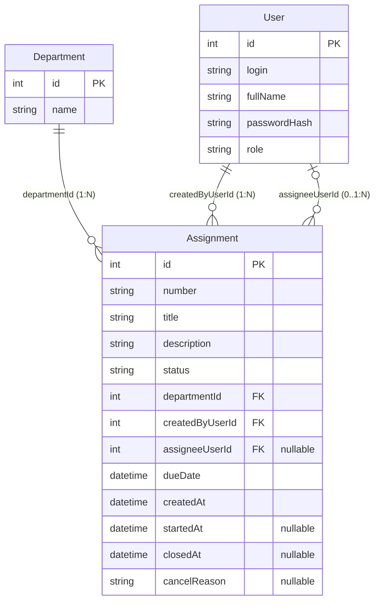

# Модель данных (TaskControl)

Курс: Б1.В.ДЭ.01.02.02 · КГЭУ · семестр 1 · 2026/2027  
Студент: Тухбатуллин Булат Айдарович · Группа: ТРИС-1-23  
Тема: Разработка системы контроля исполнения поручений руководителя в средней компании (TaskControl, ПАО «Таттелеком» — ЕЦУиМС)

---

## 1. Словарь проекта (таблица соответствия)

| Термин курса | Термин моей темы (в коде и БД) | Русское название в предметной области (ПАО «Таттелеком», ЕЦУиМС) |
|--------------|--------------------------------|------------------------------------------------------------------|
| `Ticket` | `Assignment` | Поручение руководителя |
| `Site` | `Department` | Подразделение ЕЦУиМС («Сеть доступа», «Транспортная сеть», «Мониторинг», «Эксплуатация») |
| `User` | `User` | Сотрудник (Руководитель `Manager`, Исполнитель `Executor`, Наблюдатель `Viewer`) |
| `siteId` | `departmentId` | Внешний ключ (FK) на подразделение |
| `/api/tickets` | `/api/assignments` | Базовый маршрут API для работы с поручениями |

---

## 2. Сущности, поля и ключи

### 2.1. `Department` (Справочник подразделений ЕЦУиМС)
Хранит перечень отделов внутри единого центра управления и мониторинга сети.

| Поле | Тип | Ключ / Ограничения | Описание |
|------|-----|--------------------|----------|
| `id` | `int` | **PK**, Not Null | Машинный первичный ключ подразделения |
| `name` | `string` | Not Null, Unique | Название подразделения (например, «Мониторинг», «Сеть доступа») |

### 2.2. `User` (Пользователь / Сотрудник)
Хранит учётные записи сотрудников ЕЦУиМС, которые создают, исполняют или просматривают поручения.

| Поле | Тип | Ключ / Ограничения | Описание |
|------|-----|--------------------|----------|
| `id` | `int` | **PK**, Not Null | Машинный первичный ключ пользователя |
| `login` | `string` | Not Null, Unique | Email / логин сотрудника для входа (ФТ-1, ФТ-2) |
| `fullName` | `string` | Not Null | ФИО сотрудника |
| `passwordHash` | `string` | Not Null | Хэш пароля (bcrypt/Argon2, НФТ-2) |
| `role` | `string` | Not Null | Роль: `Manager` (руководитель), `Executor` (исполнитель), `Viewer` (наблюдатель) |

### 2.3. `Assignment` (Поручение — главный объект)
Главная сущность процесса выдачи и контроля исполнения поручений руководителя.

| Поле | Тип | Ключ / Ограничения | Описание |
|------|-----|--------------------|----------|
| `id` | `int` | **PK**, Not Null | Машинный первичный ключ записи (используется в URL: `/api/assignments/17`) |
| `number` | `string` | Not Null, Unique | Человеческий номер поручения в формате `ПОР-2026-0001` (не заменяет `id`) |
| `title` | `string` | Not Null (5–80 симв.) | Заголовок поручения |
| `description` | `string` | Not Null (10–500 симв.) | Подробное описание поручения |
| `status` | `string` | Not Null | Статус: `New`, `InProgress`, `Closed`, `Cancelled` |
| `departmentId` | `int` | **FK** → `Department.id`, Not Null | Ссылка числом на подразделение ЕЦУиМС |
| `createdByUserId` | `int` | **FK** → `User.id`, Not Null | Ссылка на руководителя, создавшего поручение |
| `assigneeUserId` | `int?` | **FK** → `User.id`, Nullable | Ссылка на назначенного исполнителя (при создании может быть пустым — `null`) |
| `dueDate` | `datetime?` | Nullable (UTC) | Плановый срок исполнения поручения (ФТ-3, НФТ-4) |
| `createdAt` | `datetime` | Not Null (UTC) | Дата и время создания поручения |
| `startedAt` | `datetime?` | Nullable (UTC) | Дата и время перевода в `InProgress` (ФТ-5) |
| `closedAt` | `datetime?` | Nullable (UTC) | Дата и время закрытия в `Closed` (ФТ-6) |
| `cancelReason` | `string?` | Nullable | Причина отмены при переводе в `Cancelled` (ФТ-7) |

---

## 3. ER-диаграмма (Диаграмма сущность–связь)

### Текстовая схема

```text
+-----------------------+          1 : N          +-----------------------------------+
|      Department       |------------------------<|            Assignment             |
+-----------------------+                         +-----------------------------------+
| PK  id                |                         | PK  id                            |
|     name              |                         |     number ("ПОР-2026-0001")      |
+-----------------------+                         |     title                         |
                                                  |     description                   |
+-----------------------+          1 : N          |     status (New/InProgress/...)   |
|         User          |------------------------<| FK  departmentId                  |
+-----------------------+     (createdByUserId)   | FK  createdByUserId               |
| PK  id                |                         | FK  assigneeUserId (nullable)     |
|     login             |         1 : 0..N        |     dueDate                       |
|     fullName          |------------------------<|     createdAt, startedAt, closedAt|
|     passwordHash      |     (assigneeUserId)    |     cancelReason                  |
|     role              |                         +-----------------------------------+
+-----------------------+
```

### Диаграмма в формате Mermaid



### Описание связей словами

- **Один справочник (`Department`) — много главных объектов (`Assignment`):** к одному подразделению ЕЦУиМС может относиться множество поручений (`1 : N`).
- **Один пользователь (`User`) создаёт много объектов (`Assignment`):** один руководитель может выдать множество поручений (`createdByUserId`, связь `1 : N`).
- **Один пользователь (`User`) может быть назначен на много объектов (`Assignment`):** один сотрудник-исполнитель может выполнять несколько поручений (`assigneeUserId`, связь `1 : N`).
- **У нового объекта исполнитель может отсутствовать:** сразу после создания поручения поле `assigneeUserId` может быть пустым (`null`), а исполнитель назначается отдельным действием (Критерий 2 ЛР1).

---

## 4. Статусная модель

В базе данных и JSON-ответах используются строго четыре кода статуса:
- `New` — Новое (устанавливается сервером автоматически при создании поручения);
- `InProgress` — В работе (устанавливается назначенным исполнителем при взятии поручения в работу);
- `Closed` — Закрыто (устанавливается исполнителем по факту выполнения или руководителем);
- `Cancelled` — Отменено (устанавливается руководителем при отмене поручения; физическое удаление строк `DELETE` не используется).

---

## 5. Проверка третьей нормальной формы (3НФ)

Название справочника хранится в сущности `Department` один раз (в поле `name`). Главный объект `Assignment` (поручение) содержит только цифровой внешний ключ `departmentId`. При переименовании подразделения ЕЦУиМС (например, «Сеть доступа» → «Отдел сети абонентского доступа») меняется ровно одна строка в таблице `Department`, поэтому текст названия подразделения не дублируется в каждом поручении, аномалии обновления исключены и третья нормальная форма (3НФ) соблюдена. Аналогично ФИО и логин сотрудника хранятся один раз в таблице `User`, а в поручении хранятся только внешние ключи `createdByUserId` и `assigneeUserId`.
